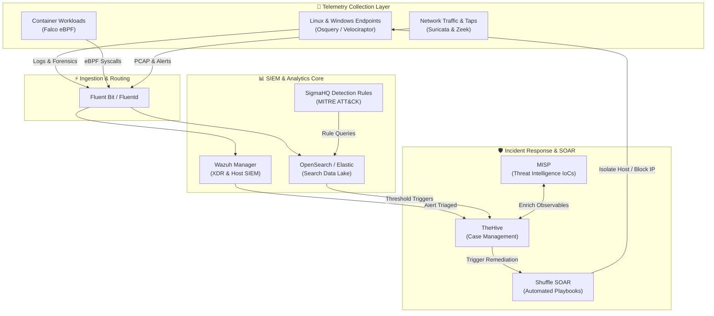

<p align="center">
  
</p>

<p align="center">
  <a href="https://github.com/ishandutta2007/Awesome-Awesome-Awesome"></a><a href="https://discord.gg/jc4xtF58Ve"></a>
  <a href="https://github.com/ishandutta2007/Awesome-Security-Operations-Secops/stargazers"></a>
  <a href="https://github.com/ishandutta2007/Awesome-Security-Operations-Secops/network/members"></a>
  <a href="https://github.com/ishandutta2007/Awesome-Security-Operations-Secops/issues"></a>
  <a href="LICENSE"></a>
  <a href="https://github.com/ishandutta2007/Awesome-Security-Operations-Secops/pulls"></a>
  <a href="https://github.com/ishandutta2007"></a>
</p>

---

# 🛡️ Awesome Security Operations (SecOps)

> **The Definitive Directory of Enterprise SaaS Platforms & Open-Source Security Operations (SecOps), Next-Gen SIEM, SOAR, Threat Detection, Incident Response, & Modern SOC Engineering.**

Welcome to the **Awesome Security Operations (SecOps)** repository — an expertly curated guide designed for SOC analysts, incident response leads, detection engineers, and Chief Information Security Officers (CISOs). This resource maps out cutting-edge **SaaS enterprise suites** alongside battle-tested **open-source security projects** covering Security Information and Event Management (SIEM), Security Orchestration, Automation, and Response (SOAR), User and Entity Behavior Analytics (UEBA), Threat Intelligence Platforms (TIP), and Endpoint Detection & Response (EDR/XDR) telemetry pipelines.

---

## 📑 Table of Contents
- [🌐 Sector Overview & Market Dynamics](#-sector-overview--market-dynamics)
- [🏢 Enterprise SaaS SecOps Platforms](#-enterprise-saas-secops-platforms)
- [🔓 Open-Source GitHub Projects (Ranked by Stars)](#-open-source-github-projects-ranked-by-stars)
- [🏗️ Blueprint: Sovereign Self-Hosted SecOps Stack](#-blueprint-sovereign-self-hosted-secops-stack)
- [🤝 How to Contribute](#-how-to-contribute)
- [💖 Support & Sponsoring](#-support--sponsoring)
- [⭐ Star History](#-star-history)
- [⚖️ Disclaimer & License](#️-disclaimer--license)

---

## 🌐 Sector Overview & Market Dynamics

The global **Security Operations (SecOps)**, **Next-Gen SIEM**, and **SOAR** market represents one of the fastest-growing sectors in enterprise software, valued at approximately **$24.5 Billion in 2024** and projected to exceed **$52.8 Billion by 2032**, expanding at a robust Compound Annual Growth Rate (**CAGR of ~14.2%**). Growth is catalyzed by exponential threat volumes, expanding cloud attack surfaces, AI-augmented cyber attacks, and an acute global cybersecurity workforce deficit.

```
┌────────────────────────────────────────────────────────────────────────────┐
│                        SecOps Market Evolution                             │
│                                                                            │
│   Historical (Tool Sprawl)                  Modern (Platform Concentration)│
│  ┌───────────────────────┐                 ┌─────────────────────────────┐ │
│  │ Disjointed Point Tools │                 │ Unified Data Lake & XSIAM   │ │
│  │ • Standalone SIEM     │    ───────►     │ • Integrated SIEM + SOAR    │ │
│  │ • Independent SOAR    │   Consolidation │ • Native EDR / UEBA / TIP   │ │
│  │ • Siloed Log Ingest   │                 │ • Autonomous AI SOC Agents │ │
│  └───────────────────────┘                 └─────────────────────────────┘ │
└────────────────────────────────────────────────────────────────────────────┘
```

The market exhibits a distinct **bifurcated structure transitioning from historical fragmentation toward strong platform concentration**:
* **Enterprise Platform Concentration (Oligopoly):** Enterprise SecOps is undergoing intense platformization. Hyperscale cloud providers and security conglomerates (Microsoft, Cisco/Splunk, Palo Alto Networks, ServiceNow, IBM) are absorbing standalone tools into unified AI-driven detection engines. This "winner-take-all" dynamic is driven by enterprise demand for vendor consolidation, lower Mean-Time-to-Detect/Respond (MTTD/MTTR), and unified data pipelines.
* **Open-Source & Sovereign Fragmentation:** Concurrently, an active open-source ecosystem (Wazuh, Elastic, Falco, OpenSearch, Suricata) maintains high fragmentation in modular tooling. This layer caters to engineering-led organizations, DevSecOps teams, and sovereignty-focused operators seeking to eliminate prohibitive per-GB ingestion taxes.

---

## 🏢 Enterprise SaaS SecOps Platforms

The table below catalogs premier commercial SaaS Security Operations platforms. Entries are **sorted descending by company size (market capitalization / enterprise valuation)**.

| 🏢 Platform / Vendor | 📈 Company Size (Valuation / Revenue) | 🎯 Core SecOps Capabilities | 💳 Pricing (Specific Starting Tier) | 🎁 Free Tier & Trial Limits |
| :--- | :--- | :--- | :--- | :--- |
| **[Microsoft Sentinel](https://learn.microsoft.com/azure/sentinel/)** *(Microsoft)* | **~$3.1 Trillion** Mkt Cap<br>*(~$245B Ann. Revenue)* | Cloud-native SIEM & SOAR powered by OpenAI foundation models, 350+ data connectors, native Microsoft Defender XDR correlation, and MITRE ATT&CK coverage mapping. | **$4.30 / GB** Pay-as-you-go ($2.46/GB Sentinel analysis + $1.84/GB Azure Log Analytics East US); Commitment tiers start at **$100.00 / day** for 100 GB/day ($2.96/GB combined). | **31-Day Free Trial** with up to **10 GB / day** free log ingestion across both Sentinel and Log Analytics (up to 20 workspaces per Azure tenant); includes $200 Azure cloud credits for new accounts. |
| **[Splunk Enterprise Security](https://www.splunk.com/)** *(Cisco Systems)* | **~$230 Billion** Mkt Cap<br>*(~$54B Ann. Rev; Splunk acquired for $28B)* | Industry-benchmark SIEM & SOAR featuring Mission Control triage, Risk-Based Alerting (RBA), multi-cloud correlation pipelines, Splunk AI Assistant, and unified TDIR workflows. | **~$1,800.00 - $2,200.00 / GB/day** annually for base Splunk Cloud platform (or Workload pricing starting at **~$6,000.00 / year**); ES add-on tier typically requires a **30%–50% uplift** on ingest volume. | **14-Day Free Trial** on Splunk Cloud capped at **5 GB / day** indexing limit; on-prem Splunk Enterprise provides a **60-day trial** (500 MB/day) reverting to **Splunk Free forever** (500 MB/day, single-user, no automated alerts). Sales-guided ES evaluations offer 30-day (Essentials) or 90-day (Premier) POC trials. |
| **[IBM QRadar SIEM](https://www.ibm.com/products/qradar)** *(IBM)* | **~$215 Billion** Mkt Cap<br>*(~$62B Ann. Revenue)* | Enterprise threat detection, log correlation, and compliance platform featuring native User Behavior Analytics (UBA), automated offense grouping, QFlow network analysis, and Watson AI enrichment. | Cloud SaaS entry on AWS/IBM Marketplace starts at **~$800.00 / month** (**$19,500.00 / year**) for a baseline tier of 100 Events Per Second (EPS) or ~$2.14 / GB ingested telemetry. | **Free Forever Community Edition** virtual appliance license (capped at **50 EPS** and **5,000 network flows/minute** with full correlation rules for non-commercial/lab usage); commercial cloud features a **14-day fully featured SaaS trial**. |
| **[ServiceNow Security Operations](https://www.servicenow.com/)** *(ServiceNow)* | **~$185 Billion** Mkt Cap<br>*(~$10.5B Ann. Revenue)* | Comprehensive enterprise SecOps on Now Platform integrating Security Incident Response (SIR), Vulnerability Response (VR), Threat Intelligence (TI), and GenAI automation agents. | Fulfiller analyst licenses start at **~$200.00 - $300.00 / user/month** (entry-level enterprise contracts start at **~$11,000.00 - $24,500.00 / fulfilled analyst/year** depending on SIR or VR bundle). | **Free Forever Personal Developer Instance (PDI)** via ServiceNow Developer Program with complete platform administrative rights and SecOps plugins enabled; or a **15-day guided enterprise sandbox** evaluation. |
| **[Palo Alto Networks Cortex XSIAM](https://www.paloaltonetworks.com/)** *(Palo Alto Networks)* | **~$115 Billion** Mkt Cap<br>*(~$8.0B Ann. Revenue)* | AI-driven autonomous SOC platform converging SIEM, SOAR, Attack Surface Management (ASM), UEBA, and XDR into a normalized multi-tenant security data lake with automated playbooks. | Ingestion analytics starts at **~£300 (~$380.00) / GB/day** annually with a mandatory **100 GB / day platform minimum** (**~$38,000.00 - $50,000.00 / year** baseline entry threshold); or **$3.50 - $4.00 / endpoint/month** for enterprise bundles. | **30-Day Guided Proof of Concept (PoC)** sandbox provisioned with sales engineering support, simulated adversary attack traffic, and pre-integrated telemetry connectors (no unassisted self-service tier). |
| **[Rapid7 InsightIDR](https://www.rapid7.com/)** *(Rapid7)* | **~$2.6 Billion** Mkt Cap<br>*(~$820M Ann. Revenue)* | Cloud-native Next-Gen SIEM & XDR pairing centralized log analytics with native User & Entity Behavior Analytics (UEBA), deception honeypots (intruder traps), and real-time endpoint investigation. | Starts at **~$5.40 / asset/month** with a standard commercial minimum entry tier of 500 monitored assets (**~$2,250.00 / month** or **~$27,000.00 / year** billed annually). | **30-Day Full-Featured Free Trial** supporting up to **250 connected assets/endpoints** with unrestricted access to cloud log search, UEBA analytics, honeypots, and detection alerts. |
| **[Exabeam New-Scale Fusion](https://www.exabeam.com/)** *(Exabeam / LogRhythm)* | **~$2.4 Billion** Valuation<br>*(Private; ~$350M combined ARR)* | Next-generation Security Operations platform uniting cloud-scale SIEM, behavioral baseline analytics, Nova AI co-pilot investigation summaries, and 1,000+ pre-built automated playbooks. | User-based pricing model starting at **~$3.50 - $5.50 / user/month** (**~$42.00 - $66.00 / user/year**) with an entry threshold minimum of 500 users (**~$21,000.00 / year** baseline). | **30-Day Guided Cloud Test Drive (PoC)** environment pre-populated with multi-vector threat simulations, automated timeline builders, and risk anomaly baselining. |
| **[Sumo Logic Cloud SIEM](https://www.sumologic.com/)** *(Francisco Partners)* | **~$1.7 Billion** Valuation<br>*(Private; ~$310M Ann. ARR)* | Cloud-native security intelligence platform transforming multi-cloud logs into normalized Records, chaining correlation rules into prioritized Insights mapped against MITRE ATT&CK. | Flex licensing model charges **~$2.55 / GB** for Cloud SIEM security analysis ($0.15/GB base ingest + $2.55/GB SIEM), with entry production packages starting around **$1,500.00 / month** (**$18,000.00 / year**). | **30-Day Free Trial** with up to **1 GB / day** data ingestion allowance, up to 20 analyst accounts, and 30-day data retention; includes access to **Sumo Logic Free forever tier** with 1 GB/day ingest and 7-day retention. |
| **[LogRhythm Axon](https://www.logrhythm.com/)** *(LogRhythm / Exabeam)* | **~$1.2 Billion** Valuation<br>*(Private; ~$200M Ann. ARR)* | Cloud-native SecOps and SIEM SaaS built ground-up for fast log ingestion, intuitive contextual search, automated case management, and seamless compliance reporting. | Axon SaaS entry package starts at **~$1,500.00 / month** (**$18,000.00 / year**) based on message ingestion volume (starting baseline tier at 1,000 Messages Per Second / MPS). | **14-Day Interactive Test-Drive Sandbox** pre-loaded with simulated cloud telemetry, active threat campaigns, rule management, and automated response actions. |
| **[LevelBlue USM](https://www.levelblue.com/)** *(formerly AlienVault USM)* | **~$1.0 Billion** Valuation<br>*(Private JV AT&T & WillCmd; ~$150M ARR)* | Unified Security Management (USM Anywhere) combining SIEM log management, asset discovery, vulnerability assessment, cloud/network intrusion detection, and Open Threat Exchange (OTX). | USM Anywhere Essentials tier starts at **$1,075.00 / month** (**$12,900.00 / year** billed annually) supporting up to 2 cloud/on-prem sensors and up to 250 GB / month log volume. | **14-Day Full-Featured Free Trial** of USM Anywhere including cloud sensor deployment in AWS, Azure, GCP, or VMware with 250 GB test data allowance (data purged after 14 days unless upgraded). |

---

## 🔓 Open-Source GitHub Projects (Ranked by Stars)

The following open-source SecOps tools empower security teams to architect robust, sovereign, and cost-effective detection engineering stacks. Each project displays its live GitHub star count and is **sorted strictly in descending order of stars**.

| # | 📦 Repository & Name | ⭐ GitHub Stars | ⚖️ License | 📝 Functional Description & SecOps Role |
| :-: | :--- | :-: | :-: | :--- |
| **1** | **[elastic/elasticsearch](https://github.com/elastic/elasticsearch)** | [](https://github.com/elastic/elasticsearch/stargazers) | AGPL-3.0 / Elastic | Distributed RESTful search, analytics engine, and backend data store power for the ELK Stack; foundation for large-scale security log indexing and Elastic Security SIEM detection rules. |
| **2** | **[grafana/loki](https://github.com/grafana/loki)** | [](https://github.com/grafana/loki/stargazers) | AGPL-3.0 | Horizontally scalable, highly available multi-tenant log aggregation system inspired by Prometheus; indexes metadata rather than raw content for hyper-cost-effective security telemetry storage. |
| **3** | **[osquery/osquery](https://github.com/osquery/osquery)** | [](https://github.com/osquery/osquery/stargazers) | Apache-2.0 | SQL-powered operating system instrumentation, monitoring, and analytics framework; exposes the OS as a high-performance relational database for live forensics and threat hunting. |
| **4** | **[wazuh/wazuh](https://github.com/wazuh/wazuh)** | [](https://github.com/wazuh/wazuh/stargazers) | GPL-2.0 | Complete open-source security platform combining endpoint XDR and SIEM; offers log analysis, file integrity monitoring (FIM), vulnerability assessment, rootkit detection, and automated active response. |
| **5** | **[opensearch-project/OpenSearch](https://github.com/opensearch-project/OpenSearch)** | [](https://github.com/opensearch-project/OpenSearch/stargazers) | Apache-2.0 | Community-driven 100% open-source search and analytics suite forked from Elasticsearch/Kibana; features dedicated Security Analytics plugin with pre-packaged Sigma rules and detector pipelines. |
| **6** | **[fluent/fluentd](https://github.com/fluent/fluentd)** | [](https://github.com/fluent/fluentd/stargazers) | Apache-2.0 | Unified data collection and log routing layer with 1,000+ community plugins; standardizes security log formatting (JSON) and safely buffers event streaming into SIEM backends. |
| **7** | **[SigmaHQ/sigma](https://github.com/SigmaHQ/sigma)** | [](https://github.com/SigmaHQ/sigma/stargazers) | DRL-1.1 | The open industry standard for writing generic, vendor-agnostic SIEM detection rules; converts standardized YAML threat signatures directly into Splunk, Elastic, Sentinel, and QRadar queries. |
| **8** | **[VirusTotal/yara](https://github.com/VirusTotal/yara)** | [](https://github.com/VirusTotal/yara/stargazers) | BSD-3-Clause | The pattern-matching Swiss Army knife for malware researchers; allows rule-based classification and identification of malicious binaries, memory artifacts, and suspicious payloads. |
| **9** | **[falcosecurity/falco](https://github.com/falcosecurity/falco)** | [](https://github.com/falcosecurity/falco/stargazers) | Apache-2.0 | CNCF Graduated cloud-native runtime security monitor; hooks deep into Linux kernel syscalls via eBPF to detect unexpected application behavior, privilege escalation, and container breaches. |
| **10** | **[fluent/fluent-bit](https://github.com/fluent/fluent-bit)** | [](https://github.com/fluent/fluent-bit/stargazers) | Apache-2.0 | Super-lightweight, high-performance log and metrics forwarder written in C; ideal for resource-constrained edge systems, container environments, and high-throughput security event pipelines. |
| **11** | **[zeek/zeek](https://github.com/zeek/zeek)** | [](https://github.com/zeek/zeek/stargazers) | BSD-3-Clause | Powerful network security monitoring (NSM) engine; inspects packet streams to generate detailed, structured application-layer transaction logs (DNS, HTTP, SSL/TLS, Kerberos, SSH). |
| **12** | **[arkime/arkime](https://github.com/arkime/arkime)** | [](https://github.com/arkime/arkime/stargazers) | Apache-2.0 | Large-scale, full-packet capture (PCAP) indexing and search platform (formerly Moloch); provides SOC analysts with granular packet examination and intuitive network session visualization. |
| **13** | **[apache/caldera](https://github.com/apache/caldera)** | [](https://github.com/apache/caldera/stargazers) | Apache-2.0 | Automated cyber adversary emulation system developed by MITRE; allows SecOps teams to automate red-team attacks, test detection coverage, and validate SOC alert readiness. |
| **14** | **[Cisco-Talos/clamav](https://github.com/Cisco-Talos/clamav)** | [](https://github.com/Cisco-Talos/clamav/stargazers) | GPL-2.0 | De-facto open-source antivirus engine for email gateway scanning, endpoint malware triage, and automated file quarantine in security operations pipelines. |
| **15** | **[OISF/suricata](https://github.com/OISF/suricata)** | [](https://github.com/OISF/suricata/stargazers) | GPL-2.0 | High-performance multi-threaded Network IDS, IPS, and Network Security Monitoring engine; capable of real-time protocol decoding, deep packet inspection, and multi-gigabit alert processing. |
| **16** | **[MISP/MISP](https://github.com/MISP/MISP)** | [](https://github.com/MISP/MISP/stargazers) | AGPL-3.0 | Open-source threat intelligence sharing platform (TIP); provides structured storage, cross-correlation of Indicators of Compromise (IoCs), and bi-directional STIX/TAXII synchronization. |
| **17** | **[ossec/ossec-hids](https://github.com/ossec/ossec-hids)** | [](https://github.com/ossec/ossec-hids/stargazers) | GPL-2.0 | Veteran open-source host-based intrusion detection system (HIDS); performs log analysis, integrity checking, Windows registry monitoring, rootkit detection, and real-time active alerting. |
| **18** | **[Velocidex/velociraptor](https://github.com/Velocidex/velociraptor)** | [](https://github.com/Velocidex/velociraptor/stargazers) | Apache-2.0 | Advanced digital forensics and incident response (DFIR) platform; leverages custom Velociraptor Query Language (VQL) scripts to hunt threats across thousands of endpoints concurrently. |
| **19** | **[TheHive-Project/TheHive](https://github.com/TheHive-Project/TheHive)** | [](https://github.com/TheHive-Project/TheHive/stargazers) | AGPL-3.0 | Scalable, open-source Security Incident Response Platform (SIRP) tailored for SOC teams; facilitates structured case management, task tracking, observable analysis, and MISP threat synchronization. |
| **20** | **[SpecterOps/BloodHound](https://github.com/SpecterOps/BloodHound)** | [](https://github.com/SpecterOps/BloodHound/stargazers) | GPL-3.0 | Graph-theory based identity attack path management platform; reveals hidden relationships, privileged access paths, and privilege escalation vulnerabilities in Active Directory and Azure. |
| **21** | **[snort3/snort3](https://github.com/snort3/snort3)** | [](https://github.com/snort3/snort3/stargazers) | GPL-2.0 | Cisco's modernized, multi-threaded open-source Network Intrusion Prevention System (NIPS); features Lua configuration, simplified rule syntax, and deep packet traffic inspection. |
| **22** | **[Shuffle/Shuffle](https://github.com/Shuffle/Shuffle)** | [](https://github.com/Shuffle/Shuffle/stargazers) | AGPL-3.0 | General-purpose open-source Security Orchestration, Automation, and Response (SOAR) tool; provides visual drag-and-drop workflow design, OpenAPI integrations, and sub-second action execution. |
| **23** | **[TheHive-Project/Cortex](https://github.com/TheHive-Project/Cortex)** | [](https://github.com/TheHive-Project/Cortex/stargazers) | AGPL-3.0 | Observable analysis and active response engine complementing TheHive; executes automated enrichment queries across 100+ threat intel services (VirusTotal, Shodan, AbuseIPDB, URLScan). |

---

## 🏗️ Blueprint: Sovereign Self-Hosted SecOps Stack

Security teams seeking to eliminate multi-thousand-dollar cloud ingest invoices can deploy an enterprise-grade sovereign detection stack using pure open source:



* **Endpoint Visibility:** Deploy **[Osquery](https://github.com/osquery/osquery)** for ad-hoc SQL telemetry queries and **[Wazuh](https://github.com/wazuh/wazuh)** for persistent file integrity monitoring and active isolation.
* **Network & Cloud Monitoring:** Run **[Suricata](https://github.com/OISF/suricata)** alongside **[Zeek](https://github.com/zeek/zeek)** for deep packet analysis, and **[Falco](https://github.com/falcosecurity/falco)** for container/eBPF runtime security.
* **Log Ingestion & Data Lake:** Route events through **[Fluent Bit](https://github.com/fluent/fluent-bit)** into **[OpenSearch](https://github.com/opensearch-project/OpenSearch)** or **[Grafana Loki](https://github.com/grafana/loki)**.
* **Detection Engineering:** Standardize all alerts using **[Sigma](https://github.com/SigmaHQ/sigma)** YAML specifications.
* **Triage & Remediation:** Escalate correlated alerts to **[TheHive](https://github.com/TheHive-Project/TheHive)**, enrich indicators with **[MISP](https://github.com/MISP/MISP)**, and trigger automated quarantine playbooks via **[Shuffle](https://github.com/Shuffle/Shuffle)**.

---

## 🤝 How to Contribute

We actively welcome contributions from SOC engineers, security researchers, and developers!

1. 🍴 **Fork the repository** to your personal GitHub account.
2. 🌿 **Create a new branch**: `git checkout -b feature/add-new-secops-tool`.
3. 📝 **Add or update entries**: Ensure SaaS entries include specific pricing tiers, trial constraints, and valuation. Open-source entries must include a verified repository link, license, and shields.io star badge linking to `/stargazers`.
4. 🔍 **Verify markdown formatting** and ensure all hyperlinks resolve cleanly.
5. 🚀 **Submit a Pull Request** with a concise description detailing the value of the tool.

---

## 💖 Support & Sponsoring

If this directory helps streamline your Security Operations workflows, saves your team hours of procurement research, or provides valuable blueprints for your SOC architecture, please consider supporting the project:

* ⭐ **Star the repository** to help others discover it across GitHub.
* 🍴 **Fork and share** it with your SOC team, cybersecurity peers, and communities.
* ☕ **Buy a coffee or sponsor ongoing maintenance**: Your support directly enables continuous indexing of emerging security tooling. Visit the **[GitHub Sponsors Dashboard](https://github.com/sponsors/ishandutta2007)** to contribute!

---

## ⭐ Star History

[](https://star-history.dera.page/#ishandutta2007/Awesome-Security-Operations-Secops&type=date&legend=top-left)

---

## ⚖️ Disclaimer & License

* **Disclaimer:** This compilation is community-curated for informational and architectural guidance. Product names, logos, and brands belong to their respective owners. Mentioning a commercial platform or open-source tool does not constitute an endorsement.
* **License:** Distributed under the permissive [MIT License](LICENSE).
